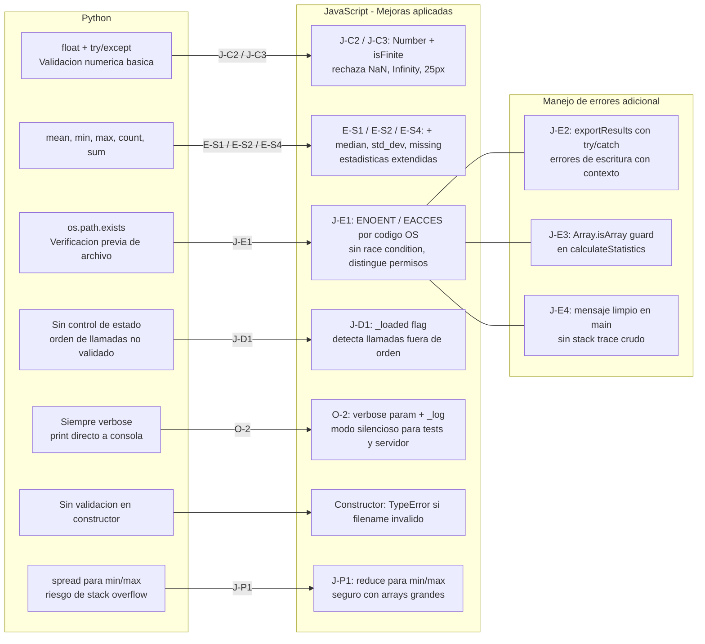

# Mejoras: Python → JavaScript

Comparativa detallada entre `source/data_processor.py` y `data_processor.js`.

---

## Diagrama de mejoras



---

## Detalle de cada mejora

### J-C2 / J-C3 — Validación numérica más estricta

| | Python `_is_numeric` | JavaScript `_isNumeric` |
|---|---|---|
| Función base | `float(value)` | `Number(String(value).trim())` |
| Acepta `"25px"` | ✅ No (lanza ValueError) | ✅ No (devuelve NaN) |
| Acepta `"Infinity"` | ⚠️ Sí | ❌ No — `isFinite()` lo descarta |
| Acepta `null` / `undefined` | ⚠️ Solo con try/except | ❌ Descartado explícitamente antes |
| Acepta cadena vacía | ⚠️ Solo con try/except | ❌ Descartado explícitamente antes |

**JS:**
```js
_isNumeric(value) {
  if (value === null || value === undefined || String(value).trim() === '') return false;
  return isFinite(Number(String(value).trim()));
}
```

---

### E-S1 / E-S2 / E-S4 — Estadísticas extendidas

Python calcula: `mean`, `min`, `max`, `count`, `sum`.

JavaScript añade:

| Métrica | Python | JavaScript |
|---|---|---|
| mean | ✅ | ✅ |
| min / max | ✅ | ✅ |
| count / sum | ✅ | ✅ |
| **median** | ❌ | ✅ |
| **std_dev** | ❌ | ✅ (muestral, ddof=1) |
| **missing** | ❌ | ✅ |

La mediana se calcula sobre una copia ordenada (`[...values].sort(...)`) para no mutar el array original.
La desviación estándar usa `ddof=1`, equivalente a `statistics.stdev` de Python.

---

### J-E1 — Lectura de archivos por código de error OS

**Python:** verifica existencia con `os.path.exists()` antes de abrir — genera una pequeña ventana de race condition.

**JavaScript:** captura el error directamente por código OS:
```js
if (err.code === 'ENOENT') throw new Error(`File not found: ${this.filename}`);
if (err.code === 'EACCES') throw new Error(`Permission denied: ${this.filename}`);
```
Distinción adicional: diferencia entre "archivo no existe" y "sin permisos de lectura".

---

### J-E2 — Escritura de archivo con contexto de error

**Python:** usa `except IOError` pero el mensaje puede ser genérico.

**JavaScript:** captura el error de escritura y lo re-lanza con nombre del archivo destino:
```js
throw new Error(`Error writing to file "${outputFile}": ${err.message}`);
```

---

### J-E3 — Guard con `Array.isArray` en `calculateStatistics`

**Python:** comprueba `if not self.data` (falsy check).

**JavaScript:** verifica tipo explícitamente:
```js
if (!Array.isArray(this.data) || this.data.length === 0)
```
Evita fallos si `this.data` fuera sobrescrito con un valor no-array.

---

### J-E4 — Manejo limpio de errores en `main`

**Python:** captura `FileNotFoundError` y `Exception` por separado con `print`.

**JavaScript:** un solo `catch` con `console.error` que muestra solo el mensaje, sin stack trace crudo al usuario final.

---

### J-D1 — Flag de estado `_loaded`

**Python:** no hay mecanismo para detectar si se llama `calculate_statistics()` antes de `load_data()`.

**JavaScript:** introduce `this._loaded = false` en el constructor, se activa en `loadData()`, y se consulta en `calculateStatistics()` para emitir una advertencia si el orden es incorrecto.

---

### O-2 — Parámetro `verbose`

**Python:** todos los `print()` son directos e inevitables.

**JavaScript:** parámetro `verbose = true` en el constructor. Toda la salida pasa por `_log()`:
```js
_log(...args) {
  if (this.verbose) console.log(...args);
}
```
Permite `new DataProcessor(file, false)` para modo silencioso — útil en tests o cuando el servidor Express consume la clase.

---

### J-P1 — `reduce` para min/max

**Python:** `min(values)` y `max(values)` iteran internamente sin límite de tamaño.

**JavaScript:** evita `Math.min(...values)` con spread operator, que causa **stack overflow** con arrays muy grandes:
```js
const min = values.reduce((a, b) => Math.min(a, b));
const max = values.reduce((a, b) => Math.max(a, b));
```

---

### Constructor — Validación de entrada

**Python:** no valida el argumento `filename` en `__init__`.

**JavaScript:** lanza `TypeError` inmediatamente si `filename` no es un string no-vacío:
```js
if (typeof filename !== 'string' || filename.trim() === '') {
  throw new TypeError('filename must be a non-empty string');
}
```

---

## Resumen de mejoras por categoría

| Categoría | Mejoras |
|---|---|
| Validación numérica | J-C2, J-C3 |
| Estadísticas | E-S1, E-S2, E-S4 |
| Manejo de errores | J-E1, J-E2, J-E3, J-E4 |
| Control de flujo | J-D1 |
| Usabilidad / testabilidad | O-2 |
| Rendimiento / seguridad | J-P1 |
| Robustez del constructor | — |

<!-- Made with Bob -->
